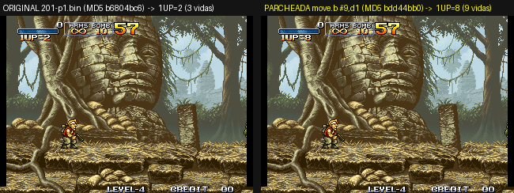
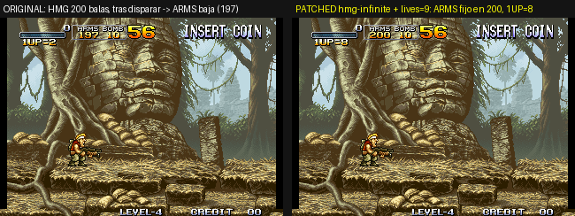
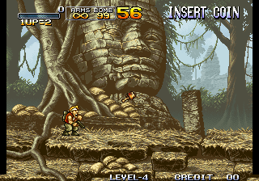

# Metal Slug 1 — Matching Decompilation

> **¿Nuevo en el proyecto?** Lee [`HANDOFF.md`](HANDOFF.md): estado completo, cómo reproducir el entorno, qué está hecho y qué queda por hacer.

[](https://github.com/correo415415/mslug-decompiled/actions/workflows/ci.yml)

A matching decompilation of **Metal Slug: Super Vehicle-001**
(Nazca / SNK, 1996) for the SNK Neo Geo MVS/AES arcade platform.

The program ROM (`201-p1.bin`) is rebuilt byte-exact from hand-written C and
annotated 68000 assembly, following the same methodology as
[n64decomp/sm64][sm64] and [zeldaret/oot][oot]. The Z80 sound driver
(`201-m1.bin`) is also reassembled byte-exact from named sources. The
graphics and sample ROMs (`201-s1`, `201-c1..c4`, `201-v1..v2`) are extracted
to PNG/WAV and rebuilt byte-exact from them.

**No copyrighted content is redistributed by this repository.** You must own a
legal copy of Metal Slug to build the ROM; the build system reads your ROM at
runtime and never bundles it.

[sm64]: https://github.com/n64decomp/sm64
[oot]: https://github.com/zeldaret/oot

---

## Current status

| ROM | Status |
|---|---|
| **P-ROM** `201-p1.bin` (68000, 2 MiB) | **100 %**: 17 608 registered sections = 2 097 152 B, rebuilt byte-identical (processed MD5 `816b3f74…`, packed `201-p1.bin` MD5 `b6804bc6…`). Code 505 608 B; the 14 data modules have A–F headers and entries named by type (`ColMap_`, `SprFrame_`, `BgMap_`, `AnimScr_`, `Pal_`) |
| **M-ROM** `201-m1.bin` (Z80 sound driver, 128 KiB) | **100 %** reassembled byte-identical (MD5 `6449db04…`): 157 named routines/tables, 0 anonymous labels, every sound data structure as symbolic source in `mrom/sound/`; music, voices and 68 effects named |
| **S/C/V-ROMs** (fix, sprites, ADPCM samples) | Extracted and rebuilt byte-identical by `assets/tools/` |

Every registered section is guaranteed to reassemble to bytes that are
bitwise identical to the original ROM. See [`CHANGELOG.md`](CHANGELOG.md) for a
headline summary of recent waves and [`docs/PROGRESO.md`](docs/PROGRESO.md)
for the full function-by-function log (in Spanish). Coverage will continue to
grow as the callgraph is walked outward from the already-matched entry points
and as large, self-contained functions are tackled directly (see
`tools/rank_candidates.py`).

---

## Repository layout

```
mslug/
├── .github/workflows/      CI: registry_lint + sizes + full matcher + build_rom + build_mrom (byte-identical ROMs)
├── src/                    Decompiled C sources (matched by GCC bare-metal 68000)
│   ├── bios/               Reset / IRQ entry points and BIOS callbacks
│   ├── kernel/             Task scheduler handlers and kernel helpers
│   ├── entity/             Entity-list helpers written in C
│   ├── video/              Palette / VRAM helpers written in C
│   └── thunks/             jsr-pc thunk tables (-mpcrel)
├── asm/                    Hand-written 68000 assembly, one folder per subsystem
│   ├── boot/               Vectors, boot script, dispatch tables, start-up
│   ├── kernel/             Scheduler, timers, memory, sound queue, soft-DIPs
│   ├── input/              Joystick decoding, input recording, HUD input
│   ├── video/              Sprites, cells, palettes, scroll, camera, fades
│   ├── entity/             Generic entity/actor framework (spawn, move, anim, collide)
│   ├── player/             Marco/Tarma: core, fire/shells, air/death/crouch, tables
│   ├── slug/               SV-001 Metal Slug vehicle
│   ├── enemies/            Rebel army
│   │   ├── soldiers/       Infantry, snipers, grenadiers, shield troopers
│   │   ├── squad/          Group/formation AI
│   │   ├── vehicles/       Tanks, planes, bazooka vehicles, walkers
│   │   └── bosses/         Tetsuyuki, Hairbuster Riberts, Allen O'Neil, …
│   ├── pow/                Prisoners of war and item drops
│   ├── props/              Destructible scenery, barrels, crates
│   ├── mission/            Mission scripts, banners, stage sequencing
│   ├── frontend/           Attract mode, title, ranking, sound test
│   └── data/               Data modules (palettes, frames, animation bytecode, tilemaps, collision, colour tables)
├── mrom/                   Z80 sound driver (201-m1.bin) — see mrom/README.md
│   ├── asm/                Named Z80 sources of the fixed region (core/channel/seq/data)
│   ├── sound/              Instruments, tables, headers and sequences as symbolic source
│   ├── map/                Blocks, symbols, split map, sound ids (inputs of the generators)
│   ├── docs/FORMATS.md     Sequence / header / instrument / tempo / channel formats
│   └── tools/              build_mrom.py, gen_*.py, export_midi.py, export_wav.py (WAV/VGM), sndrender/
├── assets/                 S/C/V-ROM extraction + reverse tools — see assets/README.md
│   ├── tools/              gfx.py, audio.py, sprites.py, levels.py, data_census.py
│   └── map/                Manual overrides (animation palettes)
├── include/                Public headers (mslug.h, mslug_regs.h)
├── linker/                 Linker scripts (neogeo.ld, neogeo_matched.ld)
├── tools/                  Active tooling used by the build — see tools/README.md
│   ├── match_batch.py      Compile + link + byte-compare every registered function
│   ├── build_rom.py        Link every section into a 2 MiB image and compare MD5
│   ├── registry.py         Master registry: (symbol, cpu_addr, size, source)
│   ├── symbols.py          External symbol table (linker --defsym)
│   ├── registry_lint.py    Static structural audit of registry.py/symbols.py
│   ├── check_section_sizes.py  Per-section size check (fast pre-matcher)
│   ├── measure_coverage.py Real-code-% heuristic feeding docs/COVERAGE.md
│   ├── gen_data_headers.py A–F headers of the asm/data modules (census + code users)
│   ├── reorg/              Folder/rename map + script used for the layout reorganisation
│   └── asm-differ/         Vendored simonlindholm/asm-differ (m68k backend)
├── scripts/                Helper scripts
│   ├── setup.sh            Process baserom into build/mslug_prom.bin + verify
│   ├── bootstrap_sandbox.sh  Install toolchain + deps + process ROM in one go
│   ├── rebuild_rom.sh      Sources → 201-p1.bin → mslug.zip
│   ├── apply_patch.sh      Gameplay + hidden-feature patches (lives, ammo, debug, sound test…)
│   ├── dev/                Emulator dev tooling (setup_internal.sh, run_emu.sh)
│   └── legacy/             Historical batch generators (Waves A–R)
├── docs/                   Design notes and reversing logs
│   ├── CONVENTIONS.md      Naming/registry/promotion conventions — read before editing
│   ├── COVERAGE.md         Real coverage analysis
│   ├── PROGRESO.md         Detailed function-by-function progress log (Spanish)
│   └── images/             Screenshots used in this README
├── internal/               DEV ONLY: romset + emulator + experiments/ recipes (removed before release)
├── build/                  Build artefacts (git-ignored)
├── diff_settings.py        Configuration for asm-differ
├── requirements.txt        Python dependencies (capstone, colorama, ...)
├── Makefile
├── CONTRIBUTING.md         Workflow for matching a new function
├── CHANGELOG.md            Headline summary of notable changes
└── README.md
```

File naming: `asm/<subsystem>/<what_it_does>_<lowest_cpu_address>.s` (e.g.
`asm/player/fire_shells_03c62a.s`). The address suffix is the lowest CPU
address of the first section in the file, so a file can be located in the ROM
at a glance; see `docs/CONVENTIONS.md`.

---

## Beyond the program ROM

All of these need the ROMs in `rom/` (`./scripts/bootstrap_sandbox.sh internal/mslug.zip`
or `./scripts/setup_assets.sh <mslug.zip>`); the output goes to `build/`, never
to git.

```bash
python3 mrom/tools/build_mrom.py              # ✔ IDÉNTICA: sound driver from mrom/
python3 assets/tools/gfx.py extract|build     # fix / sprite tiles ↔ indexed PNG  ✔ MD5 idéntico
python3 assets/tools/audio.py extract|build   # 375 ADPCM-A/B samples ↔ WAV       ✔ MD5 idéntico
python3 assets/tools/audio.py encode a|b IN.wav OUT   # WAV → ADPCM (to replace a sample)
python3 assets/tools/sprites.py extract       # 981 animations (GIF + strips) with P-ROM palettes
python3 assets/tools/levels.py                # 52 background layers, per-camera planes, parallax panoramas
python3 assets/tools/data_census.py           # per-byte type census of the P-ROM data modules
python3 mrom/tools/export_midi.py             # the 13 songs as MIDI (exact S_TEMPO)
python3 mrom/tools/export_wav.py [--vgm]      # songs, SFX and voices as game-accurate WAV / VGM
```

Details and formats: [`assets/README.md`](assets/README.md),
[`mrom/README.md`](mrom/README.md), [`mrom/docs/FORMATS.md`](mrom/docs/FORMATS.md),
[`docs/COVERAGE.md`](docs/COVERAGE.md).

---

## How it works

Metal Slug 1 is not a typical C-compiled title. Reverse-engineering the ROM
reveals structural evidence that most of the game logic was written directly
in Motorola 68000 assembly:

- Functions share epilogues (conditional branches falling through into the
  first byte of the next function).
- Values are returned via the CCR flags, not in `d0`.
- Parameter passing uses fixed register conventions (`a6` for the current
  entity, `a2` for sprite command blocks) that no C ABI would emit.
- Functions abut with no alignment padding.

Because a matching decompilation requires bit-exact output, the project uses
a **dual-frontend** model:

- **`src/*.c`** for functions whose GCC output happens to match the ROM
  byte-for-byte. This covers the ~2 900 sub-routines that are structurally
  simple: return stubs, tail-call thunks, CCR helpers, task-handler
  trampolines, dispatch tables, etc.
- **`asm/*.s`** for functions whose exact instruction sequence is not
  reproducible from C. Each `.s` file documents the conceptual C signature,
  the parameter conventions, and any structural evidence found while
  reversing the function.

Both frontends feed the same linker script, which places every registered
function at its absolute CPU address. The matcher then extracts each
function with `objcopy` and byte-compares it against the corresponding
slice of the processed P ROM.

---

## Toolchain

| Component | Version | Purpose |
|---|---|---|
| `m68k-linux-gnu-gcc` | 13.3.0 (Debian/Ubuntu) | Bare-metal C compiler for 68000 |
| `m68k-linux-gnu-as` | binutils 2.42 | GAS assembler for `.s` files |
| `m68k-linux-gnu-ld` | binutils 2.42 | Linker with custom script |
| `m68k-linux-gnu-objcopy` | binutils 2.42 | Section extraction for matching |
| `python3` | ≥ 3.10 | Build orchestration and matcher |
| `capstone` (Python) | ≥ 5.0 | Disassembly for the callee scanner |
| [asm-differ][differ] | vendored | Visual diff between built and target |

[differ]: https://github.com/simonlindholm/asm-differ

Compile flags used by the matcher (equivalent to `ngdevkit`'s
`m68k-neogeo-elf-gcc`, without the newlib runtime):

```
-mcpu=68000 -nostdlib -nostartfiles -ffreestanding -fno-builtin
-fno-exceptions -fomit-frame-pointer -fno-strict-aliasing
-fno-toplevel-reorder -fno-common -Os
-ffunction-sections -fdata-sections
```

---

## Building

### Prerequisites

```bash
sudo apt install -y gcc-m68k-linux-gnu binutils-m68k-linux-gnu \
                    python3 python3-pip
python3 -m pip install --user -r requirements.txt
```

### Bring your own ROM

Place the original program ROM at the project root:

```
rom/201-p1.bin      MD5 b6804bc6be580c80d43d187f6f9d2e7c   (arcade set "mslug")
```

### Process and verify

```bash
./scripts/setup.sh
```

This byte-swaps the ROM and swaps the two 1 MiB banks to produce
`build/mslug_prom.bin`, then verifies its MD5 against the expected
`816b3f74c76b3373993407615f1850fe`.

### Run the matcher

```bash
make match
```

or directly:

```bash
python3 tools/match_batch.py
```

A successful run prints:

```
====================================================================
  MATCHED : 17608/17608 funciones
  BYTES   : 2,097,152/2,097,152 (registrados)
  ROM     : 2,097,152/2,097,152  (100.0000%)
====================================================================
```

Also run the static registry audit (fast, no ROM needed, and what CI runs
on every push):

```bash
python3 tools/registry_lint.py
```

### Rebuild the whole ROM (and prove it is really the game)

The registry covers **100 % of the 2 MiB P-ROM** (code and data), so the
sources can be linked back into a bit-exact image:

```bash
# fuentes → build/mslug_prom_rebuilt.bin (formato CPU) → build/repack/201-p1.bin (MAME)
bash scripts/rebuild_rom.sh                              # verifica MD5 contra el original
bash scripts/rebuild_rom.sh /ruta/a/mslug.zip            # además deja build/repack/mslug.zip listo
```

Expected: `build_rom ✔ IDÉNTICA` (CPU MD5 `816b3f74…`) and
`build/repack/201-p1.bin` MD5 `b6804bc6be580c80d43d187f6f9d2e7c` — the exact
file that ships in the `mslug` romset.

To check the pipeline end-to-end, patch a game value and rebuild. Example —
start every credit with **9 lives** instead of the soft-DIP value
(`HUD_Task_Init_025706` reads `$10FD88` into the HUD task's life counter
`$77(a6)`; a 4-byte `move.b #imm,d1` keeps the function size identical).
The one-liner does the sed + size check + rebuild + zip for you:

```bash
bash scripts/patch_lives_demo.sh 9 /ruta/a/mslug.zip   # → build/repack/mslug.zip con 9 vidas
bash scripts/patch_lives_demo.sh --undo                 # deshacer el parche en el .s
```

Only 4 bytes differ from the original (`$0256B7/$0256B9` and `$02570D/$02570F`,
CPU addresses). Verified on a real emulator — the HUD shows reserve lives, so
3 lives = `1UP=2`, 9 lives = `1UP=8`:



> If you still see 3 lives: (1) make sure the emulator really loads the new
> zip (same path/name as before → delete its cache / `nvram` / save state, or
> rename the zip); (2) MAME checks CRCs and may silently fall back to a copy of
> `mslug.zip` found earlier in its `rompath`; (3) in FBNeo enable
> "accept CRC mismatch"/legacy romset; (4) the soft-DIP "Continue"/"Hero"
> settings don't matter — the patch bypasses them.

#### More patches: `scripts/apply_patch.sh`

```bash
bash scripts/apply_patch.sh             # interactive menu: pick one or several patches
bash scripts/apply_patch.sh --list
bash scripts/apply_patch.sh hmg-infinite lives=9 --zip /ruta/a/mslug.zip   # combinables
bash scripts/apply_patch.sh all-infinite bombs=99 --zip /ruta/a/mslug.zip
bash scripts/apply_patch.sh --undo
```

`hmg-infinite` replaces the 6-byte `subi.w #1,0x82(a2)` in
`PlayerFire_HMG_Spawn_03c872` with a same-size no-op (`ori.w #0,0x82(a2)`),
so the Heavy Machine Gun never consumes ammo (2 bytes change: `$03C898`,
`$03C89B`). Verified in an emulator by watching the ammo word of P1's
player entity (`$1004C2`): original 200→197 after firing, patched stays 200.



More examples: `bombs=99`, `bombs-infinite` (grenades never run out), `all-infinite`, `pistol-ammo=N` — see `scripts/apply_patch.sh --list`.

Hidden features left in the ROM by SNK, each with its own patch (verified in an
emulator; details in `internal/experiments/09_hidden_features_audit.md`):
`boot=soundtest` (internal sound test), `boot=ending`, `ending=jp|intl`,
`blood` / `no-blood` (BLOOD soft-DIP), `debug-hud` / `debugcoll` / `altjump` /
`slughud` (debug flags), `screennuke` (debug full-screen kill box),
`warpkeys` (orphan debug keys: D+B zeroes the mission timer), `asserts-off`
(92 `trap #15` asserts), `fix-input-bug` / `fix-deadstore` (original bugs).



Other handy knobs: default soft-DIP values `AttractInit_Single_099AE2`
(`$10FD88` = lives 3, `$10FD8B` = difficulty 2), soft-DIP strings at
`$1781F4` (`Str_17873c`/`Data_178001` in `data/level_d_16b035.s`), start
credits BCD at `$1081BF/$1081C0`.

---

## Continuous integration (self-hosted runner + releases)

`.github/workflows/matcher.yml` runs the full matcher on the owner's
**self-hosted runner** (labels `self-hosted, Linux, X64`) on every push to
`main` / `genspark_ai_developer`, on PRs to `main`, and on demand
(`workflow_dispatch`). No Actions cache is used: everything is rebuilt from
scratch and the results are published as **Release assets** (prerelease per
branch, plain release on `main`), tagged `matcher-<branch>-<run>-<sha7>`:

* `match_batch.txt`, `match_report_c.json`  — matcher log + per-function report
* `coverage_zones.txt`, `coverage_blocks.txt`, `registry_lint.txt`
* `registry.py`, `symbols.py`, `commit.txt`, `SHA256SUMS.txt`
* `mslug-decomp-src-<sha7>.tar.gz` — snapshot of `asm/ src/ include/ tools/ docs/ scripts/`

**The ROM never leaves the runner and is never uploaded.** The runner must
provide it in one of these ways (checked in order):

1. repository variable `MSLUG_ROM_URL` (+ optional secret `MSLUG_ROM_TOKEN`)
   pointing to `mslug.zip` or `201-p1.bin`;
2. `$MSLUG_ROM_DIR/mslug.zip` or `$MSLUG_ROM_DIR/201-p1.bin` (repository
   variable `MSLUG_ROM_DIR`, default `~/mslug_rom` on the runner).

Releases are created with the secret `RELEASE_PAT` (fine-grained PAT with
*Contents: read/write*); if absent, the workflow falls back to `GITHUB_TOKEN`.
Only the 15 most recent prereleases are kept.

## Contributing a match

See [`CONTRIBUTING.md`](CONTRIBUTING.md) for the full step-by-step
workflow (candidate selection, classification, registration, promotion of
placeholders, verification, and the git/PR process), and
[`docs/CONVENTIONS.md`](docs/CONVENTIONS.md) for the naming and registry
conventions behind it. Quick-reference tool inventory: see
[`tools/README.md`](tools/README.md).

---

## Non-goals

- This is **not** a source port. The output is a ROM image, not a native PC
  build.
- This is **not** a rewrite. Reimplementations that "look like" the original
  are not accepted; every matched function must produce the exact bytes of
  the original ROM.
- This is **not** an emulator. Run the resulting ROM in
  [MAME](https://www.mamedev.org/) or [FBNeo](https://github.com/finalburnneo/FBNeo).

---

## Legal

- Metal Slug and all associated trademarks and copyrights are the property of
  SNK Corporation. This project is not affiliated with, endorsed by, or
  connected to SNK in any way.
- No ROM data, sprite data, sound data, or any other copyrighted asset from
  the game is committed to this repository. The build system operates on a
  ROM that the user supplies.
- The source code, tools and documentation written for this project are
  released under the terms of the [MIT license](LICENSE), with the sole
  exception of the vendored `tools/asm-differ/` which retains its original
  license (see the file header).

---

## Acknowledgements

- The [NeoGeo Development Wiki](https://wiki.neogeodev.org/) for hardware
  documentation.
- Damien Ciabrini's [ngdevkit](https://github.com/dciabrin/ngdevkit) for
  establishing the modern GCC toolchain for the Neo Geo.
- Simon Lindholm's [asm-differ](https://github.com/simonlindholm/asm-differ)
  for the m68k diff backend.
- The N64 decomp community for pioneering the matching-decompilation
  methodology this project imitates.
